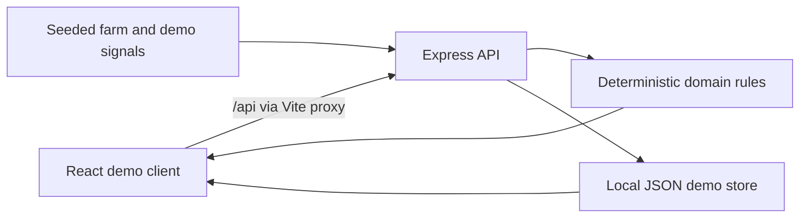

# AgriN Architecture

## Current prototype

- **Web client:** React 19, TypeScript, Vite 8. `src/App.tsx` owns the demo views and browser interactions; Leaflet/React-Leaflet renders the map, Recharts renders forecast signals, and Lucide supplies icons.
- **API:** Express 5 with TypeScript (`server/index.ts`). Vite proxies `/api` to port 4174 in development.
- **Domain rules:** `server/domain.ts` contains deterministic crop suitability scoring, farm-health scoring, threshold alerts, and contextual advisory text.
- **Persistence:** `data/demo-store.json` is created at runtime for farm activities and disease triage history. Static farm/weather/demo satellite data are currently defined in the API process. There are no database migrations.
- **Validation:** Zod validates activity and triage request bodies. The client caps image selection at 8 MB and accepts JPG, PNG, and WEBP; the image remains in browser memory and is not uploaded.

## Request flow

## Demo provider boundary

All weather and satellite readings in this build are local demonstration data, not live providers. The rule engine is the only advisor implementation. The BRICS view is a visualization of a privacy-preserving architecture concept, not a federated-training service. OpenStreetMap supplies map tiles when the browser is online; the farm polygon is illustrative.

## Production evolution

1. Move domain operations behind typed service/provider interfaces; add live weather and satellite adapters with timeouts, caching, provenance, and deterministic fallback providers.
2. Replace JSON persistence with SQLite for a single-machine deployment or PostgreSQL for multi-user operation, including migrations and audit history.
3. Add authenticated identities, role-based authorization, CSRF protections where applicable, request throttling, and server-side upload scanning/storage.
4. Add a real image model through a server-side provider, evaluation set, calibration, consent, and agronomist escalation. Do not infer disease from a filename or claim diagnostic certainty.
5. Add onboarding, verified farm boundary capture, measurement provenance, and regional data sharing consent.
6. Validate schemas against agreed interoperability standards and build a federated-learning simulation only after a real participant/security design exists.

## Environment

`PORT` selects the Express port (default 4174). `FRONTEND_ORIGIN` selects the allowed CORS origin (default `http://localhost:5173`). No API secrets are currently consumed.
